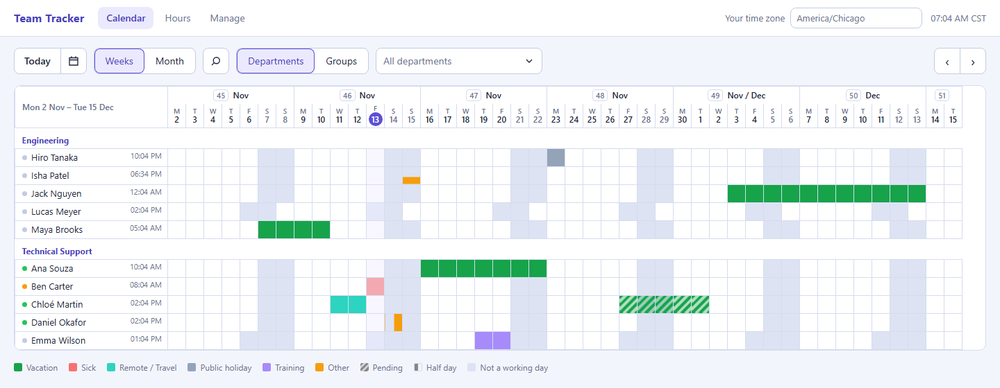
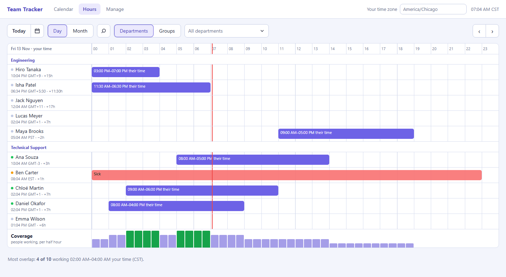
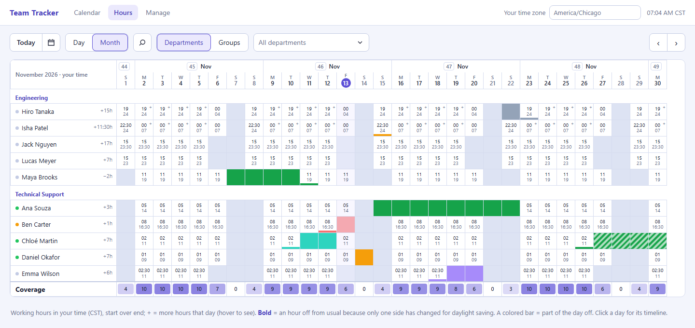
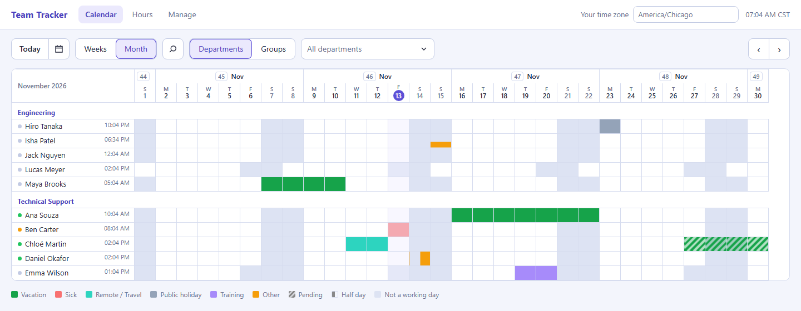
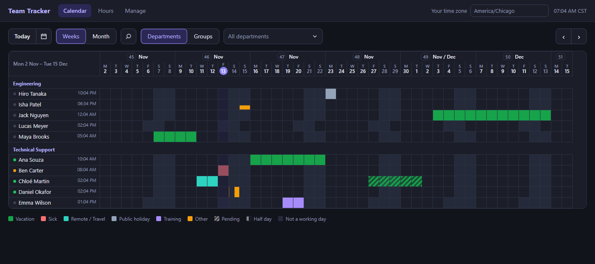
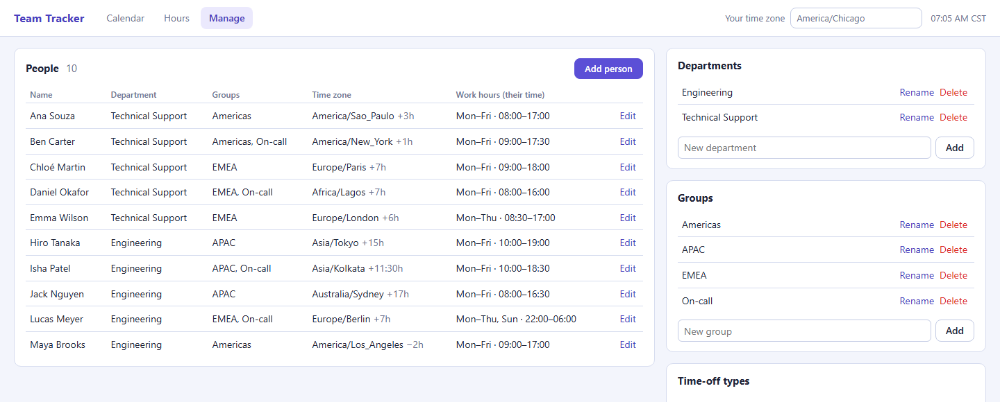

# Team Tracker

A small self-hosted web app for seeing who on your team is around: work
hours, vacations, sick days and other time off, across time zones. Runs as
one Docker container with a SQLite file for storage.

- **Calendar**: a row per person, a column per day, grouped by department
  or group. Time off is colored by type; half days, specific hours and
  pending requests have their own look; each person's non-working days are
  shaded. Drag across days to add time off, click an entry to edit it.
  **Weeks** shows a rolling range; **Month** shows exactly one month.
- **Hours**: one day as a 24-hour timeline **in your time zone**, with each
  person's work hours converted from theirs, their time off, a "now" line
  and a coverage row showing how many people are working each half hour
  (plus the best overlap window). **Month** shows a person × day grid of
  working hours in your time with daily coverage; days that are an hour
  off because only one side has changed for daylight saving are in bold.
- **Time zones**: everyone has a home zone. Their work hours and days off
  are stored in it (a day off in Paris is the Paris day); everything shown
  as a clock time is converted to the viewer's zone, which defaults to the
  browser's and can be changed in the top bar. Hovering a person shows
  their local time and their hours in yours; hovering time off shows when
  it starts and ends for you. DST is handled by the browser's own zone data.
- **Public holidays**: built in for 200+ countries and their states/regions
  (US states, German Länder, UK nations...), from offline data; nothing is
  fetched from the internet. Each person gets their country's public
  holidays automatically from their time zone (America/Chicago → US,
  Europe/Paris → France), shown like a day off. Pick a state or region, a
  different country, or none in their profile. Only official public
  holidays count, not observances or optional days like Christmas Eve.
- **Manage**: people (zone, department, groups, weekly hours, including
  night shifts that run past midnight), departments, groups and time-off
  types with their colors.
- **Sign-in**: anyone can view without signing in. People sign in with
  their Matrix account (homeservers using Matrix Authentication Service,
  set up automatically) or your company's OIDC provider (Google Workspace,
  Microsoft Entra, Authentik, Keycloak...) limited to your email domains,
  and then edit their own profile and time off. Admins edit everything.

## Screenshots

**Calendar**: who's off when, grouped by department. Shaded days are each
person's own days off; the times on the left are their local time now.



**Hours, day**: one day in your time zone, with everyone's working hours
converted from theirs, the current time in red and coverage at the bottom.



**Hours, month**: every person's working hours in your time for the whole
month, with daily coverage.



<details>
<summary>More: calendar month, dark mode, Manage</summary>







</details>

## Setup with Docker Compose

You need a Linux host with Docker Engine and the Compose plugin
(`docker compose version` should print 2.24 or newer). To let people sign
in, you also need a hostname for it (e.g. `team.example.com`) served over
HTTPS by a reverse proxy; for a quick look on your own network you can skip
that and use the admin password.

### 1. Get the code

```bash
git clone https://github.com/mspencerl87/team-tracker.git
cd team-tracker
```

### 2. Configure

```bash
cp .env.example .env
openssl rand -hex 32
```

Edit `.env`: paste that random string as `SESSION_SECRET`, set an
`ADMIN_PASSWORD`, and set `PUBLIC_URL` to the address people will open.
Then pick a sign-in method (see [Setting up sign-in](#setting-up-sign-in)):

- **Matrix homeserver with Matrix Authentication Service**: set
  `MATRIX_SERVER_NAME` and `ADMIN_USER_IDS`. Nothing to register.
- **Google, Microsoft or another OIDC provider**: set the `OIDC_*` lines,
  `ALLOWED_EMAIL_DOMAINS` and `ADMIN_EMAILS`.
- **Neither, for now**: leave both blocks commented out. Everyone can view;
  only someone with the admin password can edit.

Leave any block you don't use commented out: a half-filled one turns sign-in
on with values that don't work.

### 3. Start it

```bash
docker compose up -d --build
docker compose logs -f team-tracker
```

The log shows which sign-in methods are on, e.g.
`Team Tracker listening on :8080 (OIDC sign-in + admin password)`. Press
Ctrl+C to stop following it (the app keeps running).

### 4. Put it behind HTTPS

The container listens on port 8080. If the reverse proxy runs on the same
host, change the port line in `docker-compose.yml` to
`"127.0.0.1:8080:8080"` so it isn't reachable around the proxy.

Caddy (gets the certificate itself):

```
team.example.com {
    reverse_proxy localhost:8080
}
```

nginx:

```nginx
server {
    listen 443 ssl;
    server_name team.example.com;
    # ssl_certificate ... ; ssl_certificate_key ... ;
    location / {
        proxy_pass http://127.0.0.1:8080;
        proxy_set_header Host $host;
        proxy_set_header X-Forwarded-Proto $scheme;
    }
}
```

### 5. First sign-in

Open your `PUBLIC_URL` and click **Sign in**. Accounts listed in
`ADMIN_USER_IDS` / `ADMIN_EMAILS` become admins; everyone else is a member
and gets a person row they can adjust under **My profile**. If you're not an
admin yet, sign in with the admin password instead and promote yourself
under **Manage → Accounts**.

Then, under **Manage**, add your departments and groups and check the
time-off types. On an empty install an admin can load a sample team to look
around first; delete those people afterwards.

### Updating

```bash
git pull
docker compose up -d --build
```

The database upgrades itself on start; data, accounts and `.env` are kept.

### Without cloning

Compose can build straight from GitHub. Put this in a `docker-compose.yml`
with your `.env` next to it:

```yaml
services:
  team-tracker:
    build: https://github.com/mspencerl87/team-tracker.git#main
    image: team-tracker:latest
    restart: unless-stopped
    ports:
      - "8080:8080"
    env_file: .env
    volumes:
      - team-tracker-data:/data
volumes:
  team-tracker-data:
```

Update with `docker compose build --pull && docker compose up -d`.

### Troubleshooting

- **Sign-in page says the provider couldn't be reached**: check
  `docker compose logs team-tracker`; the line after `OIDC login:` says why.
- **Signed in but not an admin**: the account's identity (shown under Manage
  → Accounts when you sign in with the admin password) must appear exactly in
  `ADMIN_USER_IDS` / `ADMIN_EMAILS`. It's applied when you sign in, so sign
  out and in again after changing `.env` and running `docker compose up -d`.
- **List everyone who has signed in**:
  ```bash
  docker compose exec team-tracker node -e "console.table(require('better-sqlite3')('/data/team-tracker.db').prepare('SELECT email, role, created_at, last_login FROM users').all())"
  ```
- **Matrix sign-in broke after a MAS reset**: delete the saved client
  registration and restart: `docker compose exec team-tracker rm /data/oauth_client.json && docker compose restart`.

### Links to a view

A link can open a given view in a given zone, e.g.
`https://team.example.com/#view=hours&span=month&date=2026-11-01&tz=Europe/Paris`.
`view` is `calendar`, `hours` or `manage`; `span` is `month` or `weeks`/`day`.

### Settings

Put them in a `.env` next to `docker-compose.yml` (start from `.env.example`).

| Variable | Default | What it does |
| --- | --- | --- |
| `PUBLIC_URL` | | The address people open, e.g. `https://team.example.com`. Required with sign-in. |
| `MATRIX_SERVER_NAME` | | Sign in with Matrix: the domain in your Matrix IDs, e.g. `https://example.com`. Use this **or** the `OIDC_*` settings. |
| `ADMIN_USER_IDS` | | Matrix IDs (`@you:example.com`) made admins when they sign in. Same as `ADMIN_EMAILS`, which accepts Matrix IDs too. |
| `OIDC_ISSUER` | | Your provider's issuer URL (see below). Setting it and `OIDC_CLIENT_ID` turns on sign-in. |
| `OIDC_CLIENT_ID`, `OIDC_CLIENT_SECRET` | | From the app registration at your provider. |
| `OIDC_LABEL` | `Sign in with SSO` | Text on the sign-in button. |
| `ALLOWED_EMAIL_DOMAINS` | | Comma-separated, e.g. `example.com,example.co.uk`. Only these can sign in. **Leave it set**: without it, anyone the provider accepts gets in. |
| `ADMIN_EMAILS` | | Comma-separated; these accounts are made admins when they sign in. Others can be promoted under Manage → Accounts. |
| `ADMIN_PASSWORD` | | Optional break-glass admin login, for first setup or when the provider is down. |
| `SESSION_SECRET` | random per start | Signs session cookies. Set it, or everyone is signed out on each restart. |
| `OIDC_REQUIRE_VERIFIED_EMAIL` | `true` | Set `false` only if your provider doesn't mark emails verified but owns them anyway (some Authentik/Keycloak setups). |
| `OIDC_SCOPES` | `openid email profile` | |
| `PORT` | `8080` | Port inside the container. |
| `DATA_DIR` | `/data` | Where `team-tracker.db` lives (a volume in the compose file). |

With neither OIDC nor `ADMIN_PASSWORD` set, **anyone who can open the page
can edit**: fine for a quick look on a trusted network, not otherwise.

Serve it behind HTTPS (Caddy, Traefik, nginx) when it's reachable from
outside. Cookies are marked Secure when `PUBLIC_URL` is https.

### Who can do what

| | Visitor | Member (signed in) | Admin |
| --- | --- | --- | --- |
| View calendar and hours | ✓ | ✓ | ✓ |
| See email addresses | | ✓ | ✓ |
| Edit own name, zone, hours, department, groups | | ✓ | ✓ |
| Add/edit/delete own time off | | ✓ | ✓ |
| Edit other people and their time off | | | ✓ |
| Departments, groups, time-off types, accounts | | | ✓ |

The first time someone signs in, they're linked to the person with the same
email (an admin can pre-fill emails), or a new person is created in their
browser's time zone with Mon–Fri 09:00–17:00 hours for them to adjust under
**My profile**. Admins can relink accounts under Manage → Accounts.

### Setting up sign-in

**Matrix (Matrix Authentication Service)**: if your homeserver uses MAS
(its `.well-known/matrix/client` has `org.matrix.msc2965.authentication`),
there's nothing to register by hand:

```
PUBLIC_URL=https://team.example.com
MATRIX_SERVER_NAME=https://example.com
ADMIN_USER_IDS=@you:example.com
```

On the first sign-in Team Tracker finds the login server from
`MATRIX_SERVER_NAME`, registers itself as a client there, and saves that
in `oauth_client.json` in the data volume (it registers again if
`PUBLIC_URL` changes; delete the file and restart to force it). It asks only
for `openid email`: it learns who you are and your email, gets no access to
your messages or rooms, and adds no device to your account. Anyone with an
account on the homeserver can sign in; set `ALLOWED_EMAIL_DOMAINS` as well
to also require an email address at those domains on the account. People
start with a name made from their user ID (`@jane.doe` → "Jane Doe"),
which they can change under My profile.

**Other OIDC providers**: register a web application with your provider,
with redirect URI `PUBLIC_URL/auth/callback`
(e.g. `https://team.example.com/auth/callback`).

**Google Workspace**: Google Cloud console → APIs & Services → OAuth consent
screen, user type **Internal** (only your Workspace can sign in), then
Credentials → Create OAuth client ID → Web application.

```
OIDC_ISSUER=https://accounts.google.com
OIDC_LABEL=Sign in with Google
ALLOWED_EMAIL_DOMAINS=yourcompany.com
```

**Microsoft Entra ID (Microsoft 365)**: Entra admin center → App
registrations → New registration, "Accounts in this organizational directory
only", platform Web with the redirect URI; then Certificates & secrets → New
client secret. Use your tenant ID in the issuer (not `common`): the app
then trusts the sign-in name (UPN) Entra gives, which only your tenant's
admins control.

```
OIDC_ISSUER=https://login.microsoftonline.com/<tenant-id>/v2.0
OIDC_LABEL=Sign in with Microsoft
ALLOWED_EMAIL_DOMAINS=yourcompany.com
```

**Authentik / Keycloak / others**: create an OIDC provider/client
(confidential, authorization code), and use its issuer URL (the one that
serves `/.well-known/openid-configuration`).

### Backups

All data is in one SQLite file in the `team-tracker-data` volume. Make a
consistent copy while it's running, then copy that out of the container:

```bash
docker compose exec team-tracker node -e "require('better-sqlite3')('/data/team-tracker.db').backup('/data/backup.db').then(() => console.log('done'))"
docker compose cp team-tracker:/data/backup.db ./team-tracker-backup.db
```

To restore, stop it, copy the file back as `team-tracker.db`, and start it:

```bash
docker compose stop
docker compose cp ./team-tracker-backup.db team-tracker:/data/team-tracker.db
docker compose start
```

## Run without Docker

Node 20 or newer:

```bash
npm install
npm start
```

## API

JSON over HTTP with the session cookie. Reads are public; writes follow the
table above (401 when signed out, 403 when not allowed).

| Route | |
| --- | --- |
| `GET /api/data` | departments, groups, time-off types, people (emails only when signed in) |
| `GET /api/time-off?from=YYYY-MM-DD&to=YYYY-MM-DD` | entries overlapping the range |
| `GET /api/holidays?from=YYYY-MM-DD&to=YYYY-MM-DD` | public holidays per holiday key in use: `{ "US-CA": [{date, name}], ... }` |
| `GET /api/holiday-options[?country=US]` | countries, or one country's states/regions |
| `PUT /api/people/:id` | `name, email, department_id, timezone, schedule, group_ids, active, holidays` (members: own row, email and active ignored). `holidays`: `null` = from time zone, `""` = none, or `"FR"` / `"US-CA"` |
| `POST/DELETE /api/people[/:id]` | admin |
| `POST/PUT/DELETE /api/time-off[/:id]` | `person_id, type_id, start_date, end_date, part (full/am/pm/hours), start_time, end_time, status (approved/pending), note` |
| `POST/PUT/DELETE /api/departments`, `/api/groups`, `/api/leave-types` | admin; `name` (and `color` for types) |
| `GET /api/users`, `PUT/DELETE /api/users/:id` | admin; `role (member/admin), person_id` |
| `GET /api/session` | who's signed in and which sign-in methods exist |
| `GET /auth/login?tz=Zone`, `GET /auth/callback` | OIDC sign-in |
| `POST /api/login`, `POST /api/logout` | admin password, sign out |
| `GET /healthz` | liveness |

`schedule` is `{ "0": [], "1": [["09:00","17:00"]], ... }` keyed by weekday
(0 = Sunday), times in the person's zone; an end at or before the start
runs past midnight.

## License

AGPL-3.0-only. Copyright (C) 2026 Spencer LeBlanc.

Holiday data comes from [date-holidays](https://github.com/commenthol/date-holidays)
(ISC; its holiday data is CC-BY-SA-4.0).
